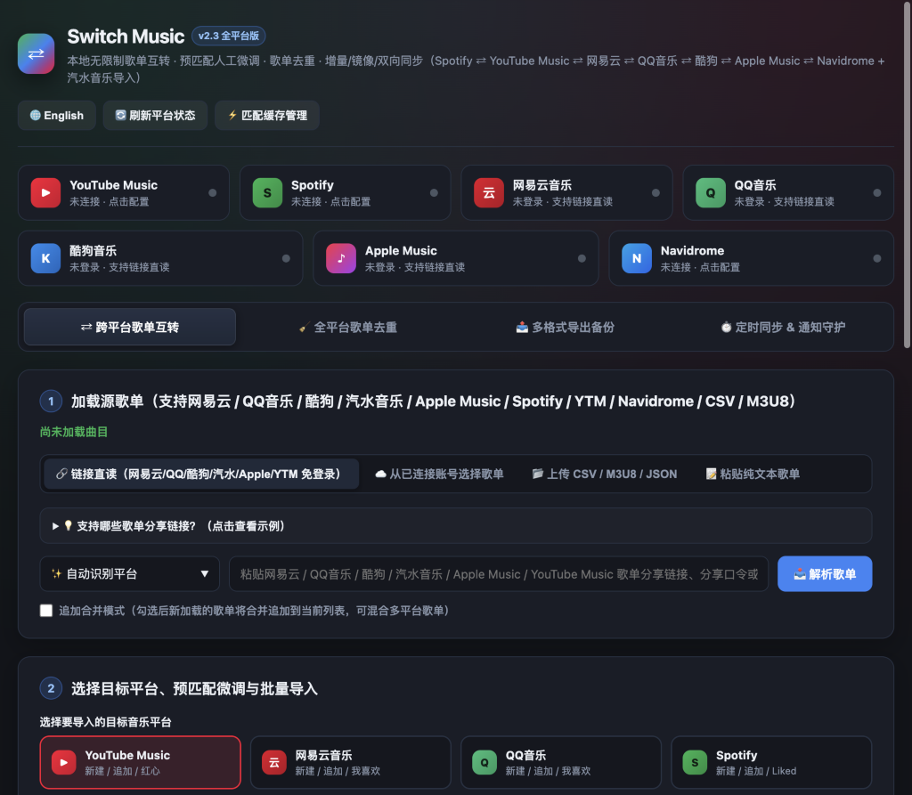
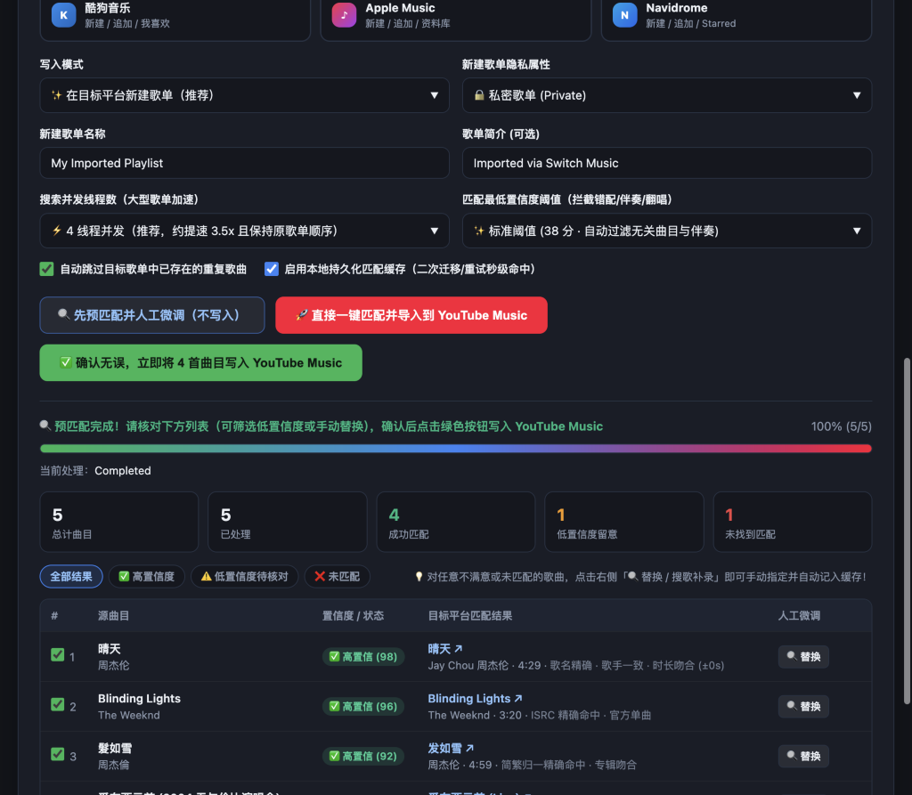
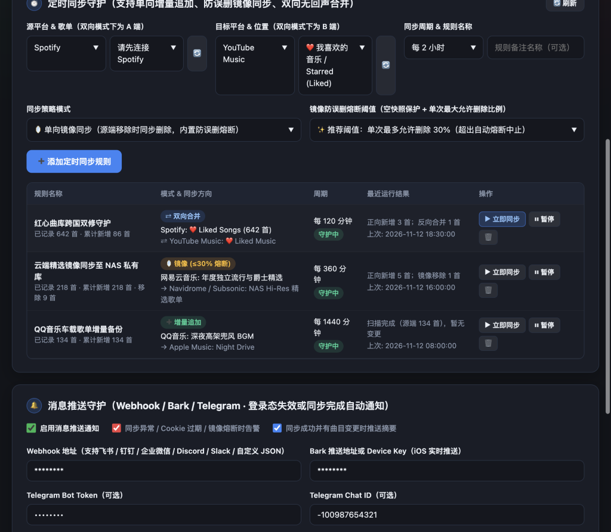
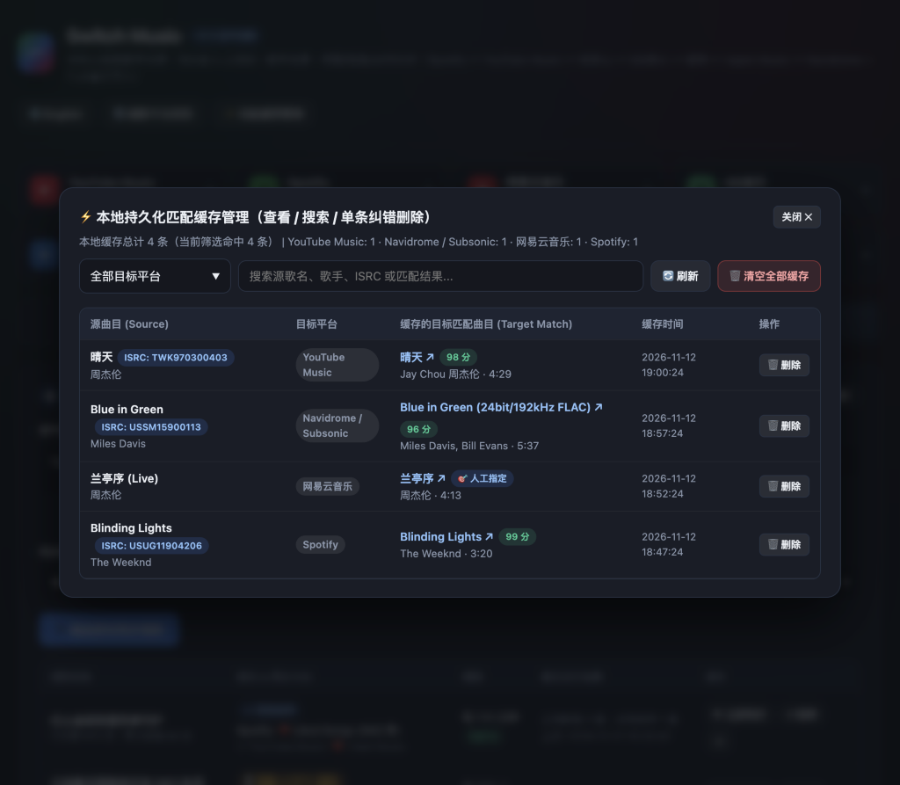
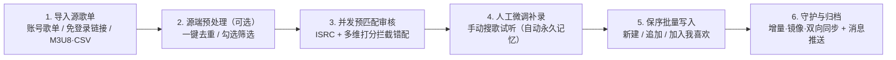

# Switch Music 🎵

[](https://github.com/AtomBoyC/switch-music/releases)
[](https://github.com/AtomBoyC/switch-music/actions/workflows/docker.yml)
[](https://hub.docker.com/r/atomboyc/switch-music)
[](https://hub.docker.com/r/atomboyc/switch-music)
[](./requirements.txt)
[](./LICENSE)

**简体中文** | [English](./README_EN.md) | [Docker 部署简明指南](./DOCKER.md)

本地自托管、无曲目上限的**全平台歌单互转、预匹配人工微调、重复曲目清理与多模式定时同步**工作台（内置 **简体中文 ⇄ English** 双语界面切换）：

> **Spotify ⇄ YouTube Music ⇄ 网易云音乐 ⇄ QQ音乐 ⇄ 酷狗音乐 ⇄ Apple Music ⇄ Navidrome / Subsonic**
>
> 同时支持 **汽水音乐（抖音音乐）** 公开歌单链接免登录直读，以及 **CSV / TSV / M3U8 (`#EXTM3U`) / JSON / 纯文本** 多格式导入与一键导出备份。

所有账号 Cookie / OAuth 令牌、NAS Subsonic 凭据、匹配缓存、迁移历史与定时同步任务均 **100% 保存在你自己的本地 `data/` 目录（或 Docker `/data` 卷）中**，绝不经过任何第三方服务器，彻底告别在线工具常见的 200~500 首曲目限制与隐私泄露风险。

---

## 📑 目录

- [界面预览](#-界面预览)
- [全平台能力矩阵](#-全平台能力矩阵)
- [核心功能与技术亮点](#-核心功能与技术亮点)
- [快速开始与部署指南](#-快速开始与部署指南)
  - [方式一：Docker / NAS 一键部署（推荐）](#方式一docker--nas-一键部署推荐)
  - [方式二：macOS 双击一键启动](#方式二macos-双击一键启动)
  - [方式三：Python 命令行源码运行](#方式三python-命令行源码运行)
- [各平台账号连接指南](#-各平台账号连接指南)
- [推荐迁移与同步流程](#-推荐迁移与同步流程)
- [常见问题排查 (FAQ)](#-常见问题排查-faq)
- [项目架构与数据目录说明](#-项目架构与数据目录说明)
- [开发、测试与版本发布](#-开发测试与版本发布)
- [开源许可与免责声明](#-开源许可与免责声明)

---

## 📸 界面预览

| 七大读写平台中枢 & 免登录链接/多格式导入 | 预匹配置信度审核 & 手动搜歌纠偏 |
| :---: | :---: |
|  |  |
| **三模式定时同步（含防误删熔断）& 消息推送守护** | **可视化匹配缓存管理与单条人工映射纠偏** |
|  |  |

---

## 📊 全平台能力矩阵

| 平台 | 免登录公开链接直读 | 账号连接方式 | 读取账号歌单 & 我喜欢 | 目标曲库搜索匹配 | 新建 / 追加 / 加入我喜欢 | 歌单去重清理 |
| :--- | :--- | :--- | :--- | :--- | :--- | :--- |
| **YouTube Music** | ✅ `music.youtube.com/playlist?list=PL...` | 浏览器 `Copy as cURL` / Cookie | ✅ 歌单 + `Liked Music` | ✅ 多轮兜底搜索 | ✅ / ✅ / ✅ | ✅ 扫描 + 定点删除 |
| **Spotify** | ⚠️ 需登录（见下方 2026 新规说明） | OAuth 2.0 官方授权 | ✅ 自建/协作歌单 + `Liked Songs` | ✅ 含 **ISRC** 精准直连 | ✅ / ✅ / ✅ | ✅ 扫描 + 保位删除 |
| **网易云音乐** | ✅ 歌单链接 / `163cn.tv` 短链（突破 1000 首截断） | 浏览器 `Copy as cURL` / Cookie | ✅ 歌单 + `我喜欢的音乐` | ✅ 纯 Python `weapi` | ✅ / ✅ / ✅ | ✅ 扫描 + 删除 |
| **QQ音乐** | ✅ 歌单链接 / `c6.y.qq.com` 短链（自动分页） | 浏览器 `Copy as cURL` / Cookie | ✅ 歌单 + `我喜欢` | ✅ `musicu.fcg` 曲库 | ✅ / ✅ / ✅ | ✅ 扫描 + 删除 |
| **酷狗音乐** | ✅ `gcid_...` 网页链接 / App 短链 / `collection_...` | **酷狗 App 扫码登录**（或客户端 token） | ✅ 自建歌单 + `我喜欢` | ✅ 客户端网关搜索 | ✅ / ✅ / ✅ | ✅ 扫描 + 删除 |
| **Apple Music** | ✅ 公开歌单 / 专辑 / `apple.co` 短链（自带 ISRC） | 网页版 `Copy as cURL`（**免开发者账号**） | ✅ 资料库歌单 + 资料库全部歌曲 | ✅ 含 **ISRC** 精准直连 | ✅ / ✅ / ✅（入库+标记喜爱） | 🔍 仅扫描定位¹ |
| **Navidrome / Subsonic** | —（私有自建曲库） | 服务器地址 + 账号密码（`MD5(pass+salt)`） | ✅ 全部歌单 + `⭐ Starred` 收藏 | ✅ `search3` + **OpenSubsonic ISRC** | ✅ / ✅ / ✅（`star` 收藏） | ✅ 扫描 + 按序倒排删除 |
| **汽水音乐 (抖音)** | ✅ `qishui.douyin.com/s/...` 分享短链 | 免登录 SSR 网页直读 | — | — | —（作为导入源迁往任意平台） | ✅ 源列表一键去重 |
| **CSV / M3U8 / JSON / 文本** | ✅ 多文件合并（兼容 Exportify / Navidrome / Soundiiz） | 本地离线解析（自动识别 UTF-8 / GB18030） | — | — | ✅ 导出 `.csv` / `#EXTM3U .m3u8` / `.json` | ✅ 源列表一键去重 |

> ¹ **说明**：Apple Music 网页版接口未开放「从资料库歌单中删除指定单曲」的端点，因此支持重复组扫描定位，实际删除需在 Apple Music 客户端中操作。除 Spotify 官方 Web API 与 Subsonic / OpenSubsonic 标准协议外，其余流媒体适配器均基于公开网页端/客户端接口实现，平台改版后可能需要跟进更新。

---

## ✨ 核心功能与技术亮点

1. **流媒体 + NAS 自建曲库全打通（8 大导入源 × 7 大双向读写目标）**
   - **免登录链接直读**：无需登录源平台，粘贴公开分享链接即可全量读取：
     - **网易云音乐**：通过全量 `trackIds` 分批拉取，自动突破网页端未登录仅显示 10~20 首及客户端 1000 首截断限制。
     - **QQ音乐**：自动解析 `c6.y.qq.com` 分享短链并分页拉取数千首规模大歌单。
     - **酷狗音乐**：本地直接解码 Base-35 `gcid_` 分享码还原 `collection_...` ID，无需经过网页端人机验证页。
     - **Apple Music**：自动抓取并缓存 `music.apple.com` 公共前端令牌，解析公开歌单/专辑时保留完整 **ISRC** 编码。
     - **汽水音乐（Soda Music）**：直接粘贴 App 分享口令中的 `qishui.douyin.com/s/...` 链接，自动提取 SSR `_ROUTER_DATA` 歌单曲目、歌手、专辑与时长。
   - **Navidrome / OpenSubsonic 深度融合**：原生支持 Subsonic API `v1.16.1` 随机盐值令牌认证，打通公有云流媒体歌单与私有 NAS 无损曲库（兼容 Navidrome、Airsonic、Gonic、LMS、Funkwhale 等），读取 OpenSubsonic 多歌手数组与 `isrc` 标签。
   - **多格式离线导入与通用备份导出**：支持拖拽多个 `.csv` / `.tsv` / `.m3u8` / `.m3u` / `.json` 文件合并导入，或将任意歌单/未匹配清单一键导出为 **Excel 友好的 UTF-8 BOM `.csv`**、**播放器/NAS 通用的 `#EXTM3U` `.m3u8`**（自动携带 `#EXTINF` 时长、专辑标签与本地相对路径）以及 **可移植 `.json`**。

2. **高精度多维曲目匹配 + 预匹配人工微调 + 可视化缓存纠偏**
   - **防踩坑多维打分模型**：综合 **ISRC 国际标准录音编码**、简繁体汉字归一、多歌手合作交叉比对、专辑名吻合度与时长误差（`±3s` 加分）计算置信度（0~100 分）；当源曲目为原版时，**自动识别并对目标曲库中的「伴奏 / Karaoke / 翻唱 / Cover / DJ版 / 慢速 / 倍速 / Live现场」大幅降权**，低于最低阈值（默认 38 分）直接拦截，杜绝乱配。
   - **先审核、后写入**：并发跑完预匹配后，可按「高置信度（≥65 分）/ ⚠️ 低置信度待核对 / ❌ 未匹配」筛选；点击 **「🔍 手动搜歌替换 / 补录」** 即可实时检索目标曲库、在线试听并手工指定目标版本。
   - **人工纠偏永久记忆 & 缓存检视器**：预匹配审核中手工指定的曲目在写入时会自动以 `👤 人工校准 (100 分)` 持久化写入 `match_cache.json`，后续增量同步或跨歌单重跑直接命中；顶部状态栏点击缓存徽章即可打开**匹配缓存管理器**，按关键词/平台检索并单条精准剔除错误映射，无需清空整库。

3. **三模式定时同步引擎 + 防误删安全熔断 + 多渠道消息推送**
   - **三种同步策略自由选择**：
     - **➕ 单向增量追加 (`append`)**：仅将源歌单新增曲目同步追加至目标歌单，适合「我喜欢的音乐」日常归档。
     - **🪞 单向镜像同步 (`mirror`)**：自动将源歌单中已移除的曲目从目标歌单同步清理，内置**双重防误删熔断保护**——**空歌单保护**（源端异常返回 0 首时绝不清空目标）+ **单次最大删除比例熔断**（默认上限 `30%`，可自定义；一旦源接口抽风返回残缺列表超阈值立即熔断报警，不删一首歌）。
     - **⇄ 双向无回声合并 (`two_way`)**：A ⇄ B 两端歌单各自新增的曲目自动互相同步补齐，内置双向指纹快照防止回声死循环。
   - **🔔 无人值守消息推送守护**：原生支持 **通用 Webhook**（自动适配**飞书 / Lark、钉钉、企业微信、Discord、Slack** 及自定义 JSON）、**Bark (iOS 推送)** 与 **Telegram Bot**，同步完成或触发登录过期/熔断告警时第一时间推送到手机。

4. **受控多线程保序加速 + 断点续传 + 全平台去重**
   - **并发匹配 + 100% 保序**：滑动窗口 `ThreadPoolExecutor`（1~6 线程可调）提速 3~5 倍的同时严格维持原歌单曲目顺序；限流 `429/502/503/504` 自动指数退避，每 100 首自动落盘存档，意外中断后一键续传。
   - **全平台歌单重复组清理器**：提供**标准 / 严格 / 深度（`±3s` 时长）**三种扫描模式，支持在线试听与自由切换保留项（Spotify 保位补回，Subsonic 按序倒排精准移除）。
   - **本地优先安全与中英双语**：`data/` 目录强制 `0700` / `0600` 权限，所有已存密钥/Webhook 地址在前端 API 中自动以 `********` 脱敏；内置 `Host` 防 DNS 重绑定白名单、`Origin` 防 CSRF 校验、`SWITCH_MUSIC_PASSWORD` 访问锁及一键 **简体中文 ⇄ English** 语言切换。

---

## 🚀 快速开始与部署指南

### 方式一：Docker / NAS 一键部署（推荐）

官方多架构镜像（`linux/amd64` + `linux/arm64`，原生支持 Intel/AMD、Apple Silicon Mac、树莓派、群晖 Synology、威联通 QNAP、飞牛 fnOS、Unraid 等）同步发布在两个仓库，标签完全一致：

- **Docker Hub**：`atomboyc/switch-music:latest`（或锁定版本如 `atomboyc/switch-music:2.3.0`）
- **GitHub Container Registry（国内拉取更快）**：`ghcr.io/atomboyc/switch-music:latest`

#### 1. 本机运行（仅本机 `127.0.0.1` 可访问）

```bash
docker run -d --name switch-music \
  -p 127.0.0.1:8765:8765 \
  -v "$PWD/data:/data" \
  --restart unless-stopped \
  atomboyc/switch-music:latest
```

启动后在浏览器访问：**http://127.0.0.1:8765**

#### 2. 使用 Docker Compose 启动

下载仓库中的 [`docker-compose.yml`](./docker-compose.yml)（或从 [GitHub Releases](https://github.com/AtomBoyC/switch-music/releases) 下载锁定版本的 `docker-compose.yml`）：

```bash
docker compose up -d
```

#### 3. 局域网 / NAS 部署示例（对局域网开放端口）

> [!CAUTION]
> 服务内部的 `/data` 目录保存着你各大音乐平台的登录凭据！**只要端口去掉了 `127.0.0.1:` 限制对局域网或公网开放，请务必同时设置 `SWITCH_MUSIC_PASSWORD` 和 `SWITCH_MUSIC_ALLOWED_HOSTS`。**

```bash
docker run -d --name switch-music \
  -p 8765:8765 \
  -v /volume1/docker/switch-music:/data \
  -e PUID=1000 \
  -e PGID=1000 \
  -e TZ=Asia/Shanghai \
  -e SWITCH_MUSIC_PASSWORD='请替换为你自己的强密码' \
  -e SWITCH_MUSIC_ALLOWED_HOSTS='192.168.1.10,nas.local' \
  --restart unless-stopped \
  atomboyc/switch-music:latest
```

#### 4. 环境变量说明

| 环境变量 | 默认值 | 说明 |
| :--- | :--- | :--- |
| `SWITCH_MUSIC_PASSWORD` | *空（不启用）* | Web 访问密码（HTTP Basic 认证，浏览器弹窗中输入**任意用户名** + 此密码即可；`/api/health` 免密供容器健康检查使用）。**非本机访问时强烈要求设置。** |
| `SWITCH_MUSIC_ALLOWED_HOSTS` | *空（仅允许回环地址）* | 允许访问的局域网 IP 或域名白名单，多个用英文逗号分隔，如 `192.168.1.10,music.example.com`；设为 `*` 允许任意 Host（仅在已开启密码或可信反代后使用）。未配置时用局域网 IP 访问会返回 `403 Forbidden host`。 |
| `SPOTIFY_REDIRECT_URI` | `http://127.0.0.1:8765/api/spotify/callback` | Spotify OAuth 回调地址。Spotify 官方仅允许 `127.0.0.1` 使用明文 `http://`；若通过公网域名访问，请配置 HTTPS 反向代理并设为 `https://你的域名/api/spotify/callback`（需与 Spotify 后台一致）。 |
| `SUBSONIC_URL` / `SUBSONIC_USER` / `SUBSONIC_PASSWORD` | *空（可选）* | 预置 Navidrome / Subsonic 服务器地址与账号密码（也可直接在 Web UI 顶部卡片配置保存）。 |
| `SWITCH_MUSIC_WEBHOOK_URL` | *空（可选）* | 预置定时同步消息推送 Webhook 地址（自动识别飞书 / 钉钉 / 企业微信 / Discord / Slack）。 |
| `SWITCH_MUSIC_BARK_URL` | *空（可选）* | 预置 iOS Bark 推送地址或 Device Key（如 `https://api.day.app/你的Key`）。 |
| `SWITCH_MUSIC_TG_BOT_TOKEN` / `SWITCH_MUSIC_TG_CHAT_ID` | *空（可选）* | 预置 Telegram 机器人 Token 与接收消息的 Chat ID。 |
| `PORT` | `8765` | 服务监听端口。 |
| `HOST` | 本地 `127.0.0.1` / 容器内 `0.0.0.0` | 服务绑定网卡地址。 |
| `SWITCH_MUSIC_DATA_DIR` | 本地 `./data` / 容器内 `/data` | 持久化数据目录路径。 |
| `PUID` / `PGID` | `10001` / `10001` | Docker 容器内运行进程的非 root 用户 UID / GID（启动脚本会自动修正 `/data` 目录归属权后通过 `setpriv` 降权运行）。 |
| `TZ` | `Asia/Shanghai` | 容器时区（影响定时同步日志与迁移历史时间戳）。 |

> [!TIP]
> **NAS 没有 HTTPS 域名时如何完成 Spotify 授权？**
> 在你的电脑终端执行一条 SSH 本地端口转发：
> ```bash
> ssh -L 8765:127.0.0.1:8765 user@你的NAS_IP
> ```
> 然后在电脑浏览器打开 `http://127.0.0.1:8765` 完成**一次** Spotify OAuth 登录即可。授权令牌会持久化保存在 NAS 的 `/data` 目录中并自动续期，之后关掉 SSH 隧道、直接用局域网 IP 访问也能正常读写 Spotify。

---

### 方式二：macOS 双击一键启动

无需安装 Node.js 或任何前端构建工具：

1. 克隆或下载本仓库代码到本地（需系统自带或安装有 Python 3.9+）。
2. 双击项目根目录下的 [`start.command`](./start.command)。
   - 首次运行会自动创建 `.venv` 虚拟环境并安装纯 Python 依赖；
   - 服务就绪后自动在默认浏览器打开 `http://127.0.0.1:8765`。

> 若首次双击提示「无法验证开发者」，在访达中按住 `Control` 键点击 `start.command` → 选择「打开」即可。

---

### 方式三：Python 命令行源码运行

适合 macOS / Linux / Windows（Python `3.9` ~ `3.13`）：

```bash
git clone https://github.com/AtomBoyC/switch-music.git
cd switch-music

python3 -m venv .venv
source .venv/bin/activate        # Windows PowerShell: .\.venv\Scripts\Activate.ps1
pip install -r requirements.txt

# 启动生产服务（默认监听 http://127.0.0.1:8765）
python app.py

# 或开发模式（代码修改自动热重载）
uvicorn app:app --host 127.0.0.1 --port 8765 --reload
```

---

## 🔑 各平台账号连接指南

> [!NOTE]
> **只是把别的平台公开歌单导出来？** 源平台（网易云、QQ音乐、酷狗、Apple Music、YouTube Music、**汽水音乐**）支持**免登录直接粘贴公开歌单分享链接**读取，你只需要连接**目标写入平台**（或需要读取私密歌单/「我喜欢」的平台）即可。

### 1. Navidrome / Subsonic（NAS 自托管音乐服直连）

1. 点击 Switch Music 顶部平台栏的 **「Navidrome」** 卡片。
2. 填入你的服务器地址（例如同局域网 `http://192.168.1.10:4533`、Docker 同网络 `http://navidrome:4533` 或外网反代 `https://music.example.com`，无需手动加 `/rest` 后缀）、用户名与密码，点击「保存并验证连接」。
3. Switch Music 采用标准 Subsonic `v1.16.1` 随机盐值令牌（`MD5(password + salt)`）通信，完美兼容 **Navidrome、Airsonic-Advanced、Gonic、Ampache、LMS、Funkwhale** 等所有 Subsonic / OpenSubsonic 协议服务端，支持读取歌单与 `⭐ Starred` 收藏、搜索曲库写入歌单、标记红心收藏及歌单去重。

---

### 2. Spotify（OAuth 2.0 双向读写授权）

1. 打开 [Spotify Developer Dashboard](https://developer.spotify.com/dashboard) 登录并点击 **Create app**。
2. 填写任意应用名称与描述，关键配置如下：
   - **Redirect URIs**：填写 **`http://127.0.0.1:8765/api/spotify/callback`** 后点击 **Add**（⚠️ **必须写 `127.0.0.1`，不能写 `localhost`**，Spotify 已禁止 `localhost` 作为回调地址）。
   - **Which API/SDKs are you planning to use?**：仅勾选 **Web API**，点击 Save。
3. 进入应用 **Settings → User Management**，填写真名与你的 **Spotify 账号注册邮箱** 把自己加入测试白名单（未添加时授权会报错或接口返回 `403`）。
4. 在 **Settings** 页复制 **Client ID** 与 **Client Secret**，填入 Switch Music 顶部的「Spotify」连接卡片，点击「保存并前往 Spotify 授权」即可。

> [!IMPORTANT]
> **Spotify 2026 年新接口规则提醒**：
> - 创建开发者应用的账号需具备有效的 **Spotify Premium** 订阅。
> - 开发模式（Development Mode）下的应用**只能读取你本人创建或参与协作的歌单曲目**。如果你想迁移在 Spotify 里收藏的「他人创建的歌单」，只需在 Spotify 客户端右键该歌单 → **添加到其他歌单 → 新建歌单**，复制一份到自己名下即可正常读取；或者通过 [Exportify](https://exportify.net/) 导出 CSV 后导入 Switch Music。

---

### 3. Apple Music（免付费开发者账号，网页版 cURL 连接）

无需开通 \$99/年的 Apple Developer 账号（Switch Music 会自动获取并缓存网页端公共开发者令牌，仅需有生效中的 Apple Music 会员订阅即可读写个人资料库）：

1. 使用浏览器打开 [https://music.apple.com](https://music.apple.com) 并登录你的 Apple 账号。
2. 按 `F12`（macOS 为 `Cmd + Option + I`）打开开发者工具 → 切换到 **Network（网络）** 面板，在过滤框输入 `amp-api.music.apple.com`。
3. 点击页面左侧「资料库 → 播放列表 / 歌曲」触发任意网络请求。
4. 在请求列表中右键任意一条发往 `amp-api.music.apple.com` 的请求（请求头内含 `media-user-token`）→ 选择 **Copy → Copy as cURL**。
5. 回到 Switch Music 顶部的「Apple Music」连接面板，粘贴并点击连接即可自动识别你的商店分区（如中国大陆 / 美区 / 港区 / 日区）。

---

### 4. 酷狗音乐（推荐手机 App 扫码一键登录）

1. 点击 Switch Music 顶部的「酷狗音乐」卡片 → 点击 **「📱 生成二维码」**。
2. 打开手机上的 **酷狗音乐 App** → 使用「扫一扫」扫描屏幕上的二维码并在手机上点击确认登录，即可自动完成客户端 `token` 与 `userid` 绑定。

> 💡 **说明**：浏览器网页版 `www.kugou.com` 的普通登录 Cookie 没有客户端云歌单读写权限，因此强烈建议直接使用内置扫码登录（高级用户也可直接粘贴包含 `{"token": "...", "userid": "..."}` 的 JSON 或客户端 Cookie）。

---

### 5. 网易云音乐 / QQ音乐 / YouTube Music（通用 `Copy as cURL` 连接）

这三个平台均内置了统一的多格式凭据解析器（支持 **Copy as cURL**、**Copy as fetch (Node.js)**、原始 **Request Headers**、**Cookie-Editor JSON** 及 **Netscape `cookies.txt`**）：

| 平台 | 登录网址 | Network 面板推荐筛选关键词 | 必需的关键凭据字段（自动校验） |
| :--- | :--- | :--- | :--- |
| **网易云音乐** | [https://music.163.com](https://music.163.com) | 刷新页面或点「我的音乐」，筛选 `weapi` | Cookie 中需含 `MUSIC_U` |
| **QQ音乐** | [https://y.qq.com](https://y.qq.com) | 点击「我的音乐」，筛选 `musicu.fcg` | Cookie 中需含 `uin`（或 `wxuin`）与 `qm_keyst`（或 `qqmusic_key`） |
| **YouTube Music** | [https://music.youtube.com](https://music.youtube.com) | 点击左侧「媒体库 (Library)」，筛选 `browse` | Cookie 中需含 `__Secure-3PAPISID` 或 `SAPISID`（多品牌账号自动保留 `x-goog-authuser`） |

**通用三步法**：在浏览器登录对应官网 → 打开开发者工具 **Network** 面板触发请求 → 右键匹配请求选择 **Copy → Copy as cURL**（Windows Chrome 若有两个选项选 `Copy as cURL (bash)` 即可；**切勿选择不带 Cookie 的普通 `Copy as fetch`**）→ 粘贴到对应平台卡片保存。

---

## 🧭 推荐迁移与同步流程



1. **加载源歌单**：在左侧选择从已连接账号拉取歌单、粘贴公开分享链接直读（支持网易云、QQ、酷狗、Apple Music、YTM、汽水音乐整段分享文案自动提取链接），或上传 `.csv` / `.m3u8` / `.json` / 纯文本歌单。
2. **设定目标与并发参数**：在右侧 7 大目标平台中选择写入方式（新建歌单 / 追加到现有歌单 / 加入「❤️ 我喜欢」）以及并发线程数（日常建议 `3~4` 线程；超大规模 3000+ 首歌单建议 `2~3` 线程以降低目标平台风控概率）。
3. **运行「🔍 先预匹配审核」**：等待并发搜索完成后，切到「⚠️ 低置信度」与「❌ 未匹配」标签页，点击「手动搜歌替换 / 补录」在线核对冷门曲目；你手工指定的版本会自动写入本地缓存，未来无需二次挑选。
4. **确认写入 / 定时守护**：确认无误后点击「确认并开始写入」；对于「我喜欢的音乐」或常更新歌单，可在底部创建 **增量追加 / 防误删镜像 / 双向合并** 定时任务，并在「🔔 消息推送守护」卡片开启飞书/钉钉/Bark/Telegram 通知。

---

## ❓ 常见问题排查 (FAQ)

<details>
<summary><b>Q1：通过局域网 IP 或域名打开页面时显示 <code>403 Forbidden host</code>？</b></summary>

出于安全设计，服务默认只响应 `127.0.0.1` 与 `localhost` 请求头，防止你在浏览恶意网站时遭遇 DNS 重绑定攻击窃取本地音乐账号凭据。
若部署在 NAS 或服务器上，请通过环境变量添加允许访问的 IP 或域名（并务必同时设置访问密码）：
```bash
SWITCH_MUSIC_PASSWORD="your-strong-password"
SWITCH_MUSIC_ALLOWED_HOSTS="192.168.1.10,music.yourdomain.com"
```
</details>

<details>
<summary><b>Q2：粘贴浏览器复制的内容后提示「未能提取到有效的 Cookie」或「缺少登录凭据」？</b></summary>

1. 请确认右键菜单选的是 **`Copy → Copy as cURL`**（或 `Copy as fetch (Node.js)`），**不要选普通的 `Copy as fetch`**（现代浏览器出于安全限制会在普通 `Copy as fetch` 中剥离全部 `Cookie` 头）。
2. 请确认复制的是发往主站 API 域名（如 `music.163.com/weapi`、`u.y.qq.com/cgi-bin/musicu.fcg`、`music.youtube.com/youtubei`、`amp-api.music.apple.com`）的请求，而不是静态图片/字体请求（静态 CDN 请求不携带登录 Cookie）。
</details>

<details>
<summary><b>Q3：Spotify 报错 <code>INVALID_CLIENT: Invalid redirect URI</code>，或者连接后歌单曲目数为 0？</b></summary>

- **`Invalid redirect URI`**：检查 Spotify 开发者后台填写的 Redirect URI 是否与页面上显示的完全一致（一字不差），且本地必须是 `http://127.0.0.1:8765/api/spotify/callback`（不能用 `localhost`）。
- **授权时跳 403 或无法读取信息**：请前往 Spotify 开发者后台 **Settings → User Management**，把你当前登录的 Spotify 账号邮箱加进白名单，并确认开发者账号拥有 Spotify Premium。
- **他人创建的歌单显示 0 首或无法读取**：受 Spotify 2026 年 2 月 Web API 新规限制，开发模式应用只能读取本人创建或协作的歌单；在 Spotify 客户端内将该歌单全选复制到自己新建的歌单中即可正常读取。
</details>

<details>
<summary><b>Q4：镜像同步（Mirror）会不会因为源平台登录过期或网络抽风把我的目标歌单删空？</b></summary>

不会。Switch Music 的镜像同步内置了**两层硬性安全熔断**：
1. **空快照熔断**：若源歌单返回 0 首（如 Cookie 失效或平台限流），立即中止本轮清理并推送异常通知，绝不清空目标歌单；
2. **单次最大删除比例熔断**：默认单轮最多只允许删除目标歌单总曲目数的 `30%`（可在创建规则时自定义 `5%~90%`）。一旦待删数量超出阈值，调度器会立即拒绝执行删除操作、保留现场快照并告警。
</details>

<details>
<summary><b>Q5：国内环境 <code>docker pull atomboyc/switch-music:latest</code> 拉取缓慢怎么办？</b></summary>

可以直接改用同步发布的 GitHub Container Registry 镜像（支持完全相同的版本号标签与 `amd64`/`arm64` 双架构）：
```bash
docker pull ghcr.io/atomboyc/switch-music:latest
```
并在 `docker-compose.yml` 中将 `image:` 替换为 `ghcr.io/atomboyc/switch-music:latest`。
</details>

---

## 📂 项目架构与数据目录说明

### 代码目录结构

```text
switch-music/
├── app.py                        # FastAPI 应用入口、安全中间件 (Host/CSRF/BasicAuth) 与 REST API 路由
├── backend/
│   ├── config.py                 # 环境变量、持久化路径、0600 原子 JSON 读写与通用 cURL/Cookie 解析器
│   ├── models.py                 # Pydantic 请求与曲目数据模型
│   ├── text_utils.py             # 简繁汉字转换、噪音清洗与版本特征（伴奏/Live/翻唱/DJ）提取
│   ├── matcher.py                # 多维匹配打分引擎、渐进兜底搜索、人工映射记忆与单条缓存检索/清理
│   ├── csv_io.py                 # CSV / TSV / M3U8 (#EXTM3U) / JSON / 纯文本解析与多格式导出
│   ├── deduplicator.py           # 源列表与全平台歌单重复组分析引擎（标准/严格/深度三模式）
│   ├── migration_engine.py       # 滑动窗口多线程保序匹配、预匹配审核、断点存档与串行重试写入
│   ├── sync_scheduler.py         # 后台定时同步引擎（增量追加 / 防误删熔断镜像 / 双向无回声合并）
│   ├── notifier.py               # 多渠道消息推送守护（飞书/钉钉/企微/Discord/Slack Webhook、Bark、Telegram）
│   └── providers/
│       ├── __init__.py           # 平台注册表与公开歌单链接平台自动嗅探
│       ├── base.py               # 统一音乐平台抽象基类 (PlatformProvider)
│       ├── ytm.py                # YouTube Music 适配器 (SAPISIDHASH 签名、读写与去重)
│       ├── spotify.py            # Spotify 适配器 (2026 Web API、OAuth 双向读写、ISRC 与保位去重)
│       ├── netease.py            # 网易云音乐适配器 (纯 Python 零编译依赖 weapi AES-128-CBC + RSA)
│       ├── qqmusic.py            # QQ音乐适配器 (musicu.fcg 网关、短链解析、g_tk 签名与读写去重)
│       ├── kugou.py              # 酷狗音乐适配器 (App 扫码登录、Base-35 gcid 解码、客户端签名网关)
│       ├── applemusic.py         # Apple Music 适配器 (amp-api 公共令牌自动抓取缓存、ISRC 搜索与资料库读写)
│       ├── subsonic.py           # Navidrome / Subsonic 适配器 (v1.16.1 盐值认证、OpenSubsonic ISRC、读写与去重)
│       └── qishui.py             # 汽水音乐适配器 (qishui.douyin.com 分享短链免登录 SSR 解析)
├── static/                       # 零 Node.js 构建依赖的原生模块化前端
│   ├── index.html                # 单页工作台视图结构
│   ├── css/styles.css            # 响应式深色玻璃拟态主题样式
│   └── js/
│       ├── i18n.js               # 简体中文 ⇄ English 双语词典与动态文案切换器
│       └── app.js                # 前端状态管理与交互控制器
├── docs/
│   └── screenshots/              # README 高清功能界面预览截图
├── tests/
│   └── test_core.py              # 匹配打分、多格式导入导出、三模式同步熔断、Subsonic/汽水与 API 单元测试
├── .github/
│   ├── workflows/docker.yml      # GitHub Actions：自动单测 + 容器冒烟测试 + 双仓库多架构构建 + Release
│   └── release-notes/            # 各版本 GitHub Release 发行说明归档
├── Dockerfile                    # 基于 python:3.12-slim 的轻量镜像定义（含 HEALTHCHECK）
├── docker-entrypoint.sh          # 自动修正 /data 权限并通过 setpriv 降权至 PUID:PGID 运行
├── docker-compose.yml            # 开箱即用的 Docker Compose 编排模板
├── DOCKER.md                     # 自动同步至 Docker Hub 仓库主页的镜像文档
├── LICENSE                       # MIT 开源许可证
├── README_EN.md                  # 英文版完整项目文档
├── requirements.txt              # 纯 Python 依赖清单（无 C/Rust 编译负担）
└── start.command                 # macOS 双击启动脚本（自动建虚拟环境 + 端口就绪检测）
```

### 持久化数据目录 (`data/` 或容器内 `/data`)

所有运行期状态均采用原子写入（`.tmp` + `os.replace`）并强制 `0600` 权限存放在数据目录中，备份或迁移服务器时直接拷贝该目录即可：

| 文件 / 目录 | 用途说明 |
| :--- | :--- |
| `ytm_browser.json` / `netease_auth.json` / `qqmusic_auth.json` | YouTube Music、网易云音乐、QQ音乐的本地认证凭据 |
| `spotify_config.json` / `.spotify_cache` | Spotify OAuth 应用配置与自动续期的访问令牌缓存 |
| `kugou_auth.json` / `kugou_device.json` | 酷狗音乐登录凭据与虚拟客户端设备标识 |
| `applemusic_auth.json` / `applemusic_dev_token.json` | Apple Music 用户令牌与自动缓存的前端公共开发者令牌 |
| `subsonic_auth.json` | Navidrome / Subsonic 服务器地址、用户名与本地凭据（前端接口自动脱敏） |
| `notification_config.json` | Webhook / Bark / Telegram 消息推送配置（前端接口自动 `********` 脱敏） |
| `match_cache.json` | 跨歌单曲目匹配与人工校准缓存（上限 15,000 条，TTL 30 天，支持 UI 内检索与单条删除） |
| `migration_history.json` & `jobs/` | 迁移历史汇总（最近 60 条）与进行中/中断任务的断点恢复快照 |
| `sync_tasks.json` | 后台定时同步规则（增量/镜像/双向）与已同步曲目指纹快照 |

---

## 🔧 开发、测试与版本发布

### 运行单元测试

```bash
./.venv/bin/python -m unittest discover -s tests -t . -v
```

### 健康检查接口

```bash
curl http://127.0.0.1:8765/api/health
# {"status":"ok","version":"2.3.0"}
```

### CI/CD 与版本发布流程

仓库已配置完整的 GitHub Actions 流水线（[`.github/workflows/docker.yml`](./.github/workflows/docker.yml)）：

1. **日常推送 / PR**：自动运行 Python 单元测试与 Docker 容器非 root 权限冒烟测试；合并至 `main` 分支后自动构建 `linux/amd64` + `linux/arm64` 镜像推送 `:latest`，并将 [`DOCKER.md`](./DOCKER.md) 同步更新至 Docker Hub 主页。
2. **发布正式版本**：
   - 在 `.github/release-notes/vX.Y.Z.md` 编写本版本更新亮点，并同步更新 `app.py` 中的 `APP_VERSION`；
   - 推送语义化标签：
     ```bash
     git tag v2.3.0
     git push origin v2.3.0
     ```
   - GitHub Actions 会自动发布 `:2.3.0` 与 `:2.3` 多架构镜像至 Docker Hub 与 GHCR，并创建附带锁定版本 `docker-compose.yml` 资产包的 [GitHub Release](https://github.com/AtomBoyC/switch-music/releases)。

---

## 📜 开源许可与免责声明

本项目基于 **[MIT License](./LICENSE)** 开源许可发布。

1. **个人自用工具**：本项目仅作为个人音乐歌单元数据整理、跨平台迁移与防丢失备份工具，**不包含任何音频流下载、解密或盗版分发功能**。
2. **数据隐私**：所有平台 Cookie、Token 等敏感信息仅保存在用户自行控制的本地磁盘或私有容器中，请勿将未设强密码的实例直接暴露于公网。
3. **非官方接口提示**：除 Spotify 官方 Web API 与 Subsonic / OpenSubsonic 开放标准协议外，其余平台适配器均基于公开网页端或客户端协议实现，仅供个人学习与管理自有账号歌单使用；请合理控制并发与同步频率，尊重各音乐平台的服务条款。
